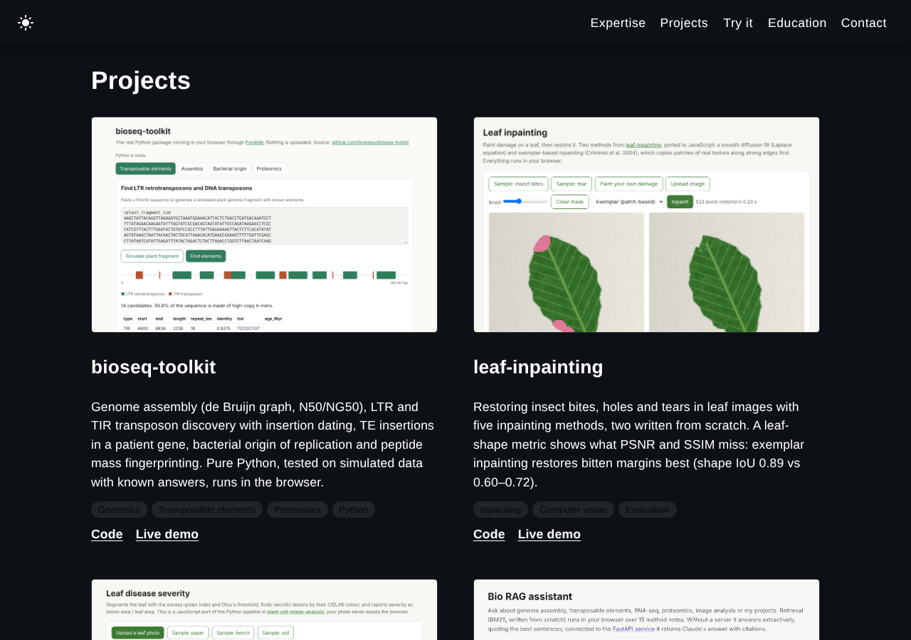

# liuweisu.github.io

My portfolio site: bioinformatics, image analysis and AI engineering projects, each with a live demo that runs in the browser.

Built on [react-portfolio-template](https://github.com/yujisatojr/react-portfolio-template) by Yuji Sato (MIT). Changes from the template:

- All content lives in one file, [`src/data/portfolio.ts`](src/data/portfolio.ts); the components only render it.
- A new **Try it** section ([`src/components/Demos.tsx`](src/components/Demos.tsx)) embeds each project's GitHub Pages demo in a tabbed frame, loading only the selected one.
- Project cards show tags and separate *Code* / *Live demo* links.
- Deployment through GitHub Actions instead of the `gh-pages` package.



## How the pieces fit together

```
github.com/liuweisu/bioseq-toolkit        ──(Pages)──>  liuweisu.github.io/bioseq-toolkit/            ┐
github.com/liuweisu/leaf-inpainting       ──(Pages)──>  liuweisu.github.io/leaf-inpainting/           │  embedded in
github.com/liuweisu/plant-cell-image-analysis ──────>  liuweisu.github.io/plant-cell-image-analysis/  │  the "Try it"
github.com/liuweisu/bio-rag-assistant     ──(Pages)──>  liuweisu.github.io/bio-rag-assistant/         │  section
github.com/liuweisu/genomics-biobank-sql  ──(Pages)──>  liuweisu.github.io/genomics-biobank-sql/      ┘
github.com/liuweisu/liuweisu.github.io    ──(Pages)──>  liuweisu.github.io   (this site)
```

Each project repository publishes its own demo with a workflow in `.github/workflows/pages.yml`. This site only links to and embeds those pages, so a demo is updated by pushing to its own repository.

## Editing the site

```bash
npm ci
npm start            # http://localhost:3000, reloads on save
```

Then edit `src/data/portfolio.ts`:

| What | Where in `portfolio.ts` |
| --- | --- |
| Name, headline, intro, LinkedIn | `profile` (lines marked `TODO`) |
| Photo | `profile.avatar` uses your GitHub avatar; or put `me.jpg` in `src/assets/images/`, `import me from '../assets/images/me.jpg'` and set `avatar: me` |
| Skill cards and their tags | `skills` (icons: `dna`, `image`, `robot`; add more in `Expertise.tsx`) |
| Education and jobs | `timeline` (replace the `TODO` years, programme and university) |
| Projects | `projects`: title, description, image, `repo`, optional `demo`, tags |
| Which demos appear under "Try it" | every project with a `demo` URL, in the order of `projects` |

### Adding a new project

1. Put a screenshot (about 1280 x 800) in `src/assets/images/projects/`.
2. Import it at the top of `portfolio.ts` and add an entry to `projects`.
3. If the project has a page on GitHub Pages, set `demo: pages('repo-name')` and it appears under "Try it" automatically.

### Making any project interactive

A demo is just a static `index.html` that GitHub Pages serves. The five projects use three patterns you can copy:

| Pattern | Used in | When to use |
| --- | --- | --- |
| Run the real Python package in the browser with [Pyodide](https://pyodide.org) | bioseq-toolkit | Pure-Python code (standard library, or packages Pyodide ships such as NumPy and pandas) |
| Ship data and run a WebAssembly engine | genomics-biobank-sql (SQLite via sql.js) | Databases, precomputed indexes |
| Port the core algorithm to JavaScript | plant-cell-image-analysis, leaf-inpainting, bio-rag-assistant | Image processing or anything that needs to feel instant |

Anything that needs a GPU, a large model or an API key (Stable Diffusion inpainting, Claude answers, a local LLM) cannot run on GitHub Pages. Show recorded results or screenshots for those, or deploy a small API (for example the bio-rag-assistant Docker image on Render, Fly.io or Hugging Face Spaces) and let the demo page call it.

## Publishing

This repository must be named **`liuweisu.github.io`** so that it is served at the root, `https://liuweisu.github.io`.

1. Push to `main`.
2. On GitHub: **Settings → Pages → Build and deployment → Source: GitHub Actions** (once).
3. The workflow in `.github/workflows/deploy.yml` builds the site and publishes it; the URL appears in the run summary.

Do the same Pages setting once in every project repository so their demos go live. If you would rather name this repository `portfolio`, set `"homepage": "https://liuweisu.github.io/portfolio"` in `package.json`; nothing else changes.

### Contact form

The form is inactive, as in the template. To make it send email, create a free [EmailJS](https://www.emailjs.com/) account, `npm install @emailjs/browser`, and uncomment the block in `src/components/Contact.tsx` with your service, template and public key.

## License

MIT, see [LICENSE](LICENSE) (template copyright Yuji Sato).
